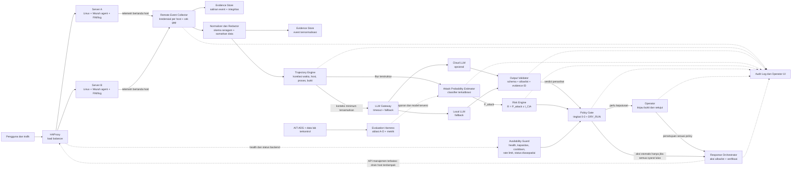

# Arsitektur DEFNETT

**Versi:** 2.0  
**Status:** Rancangan untuk prototipe laboratorium  
**Dokumen acuan:** `DEFNETT_PRD_v1.md` dan `DEFNETT_Blueprint_v2.md`

## Tujuan

DEFNETT memantau dua server Linux di belakang HAProxy, menghubungkan alert menjadi rangkaian kejadian, menghitung risiko dari bukti, lalu merekomendasikan atau menjalankan respons yang dibatasi kebijakan. Purwarupa berjalan di lab dan memulai respons dalam mode `DRY_RUN`.

FIM mendeteksi perubahan file dan mengirim event ke sistem. Pemindaian hash harian untuk semua file dan penghapusan file otomatis bukan bagian MVP. LLM menganalisis konteks sebagai penasihat; komponen deterministik yang memvalidasi bukti dan kebijakan mengendalikan tindakan.

## Diagram arsitektur

## Zona kepercayaan

| Zona | Komponen | Aturan |
|---|---|---|
| Layanan | HAProxy, Server A, Server B | Host yang dipantau dianggap dapat dikompromi. Agent mengirim FIM, log, dan status telemetri. |
| Kontrol | Collector, Evidence Store, normalizer, trajectory, classifier, Risk Engine, Policy Gate, orchestrator, audit | Berjalan terpisah dari server layanan. Kredensial dan hak akses dipisah per komponen. |
| Analisis AI | LLM Gateway, Cloud LLM opsional, Local LLM | Hanya menerima konteks minimum yang sudah disamarkan. Tidak memiliki shell, root, atau akses langsung ke load balancer. |
| Evaluasi | Dataset AIT-ADS dan data lab | Jalur offline terpisah dari keputusan operasional. Metrik AIT-ADS dan lab dilaporkan sendiri-sendiri. |

## Alur pemrosesan

1. Pengguna mengakses layanan melalui HAProxy. HAProxy meneruskan trafik ke backend yang sehat.
2. Agent pada Server A dan B mengirim event FIM, log, dan status agent menggunakan identitas host masing-masing.
3. Collector memeriksa sumber, identitas, timestamp, dan gap telemetri. Event mentah disimpan terpisah sebelum normalisasi agar bukti tidak bergantung pada host sumber.
4. Normalizer memetakan event ke skema internal dan menyamarkan data sensitif. Event mentah dan versi ternormalisasi mendapat referensi bukti yang saling terkait.
5. Trajectory Engine mengelompokkan event menurut waktu, host, proses, file, dan hubungan lain. Event yang hilang, terlambat, atau tidak terverifikasi ditandai; kondisi itu tidak dianggap sebagai keadaan aman.
6. Classifier menghitung `P_attack` dari fitur trajectory. Secara paralel, LLM dapat merangkum konteks dan menyarankan verdict dengan referensi evidence ID.
7. Output Validator menolak JSON yang tidak sesuai schema, reason code di luar allowlist, dan evidence ID yang tidak ada.
8. Risk Engine menghitung `R = P_attack x I_CIA` dari matriks dampak aset. Risk Engine menyimpan input, versi konfigurasi, dan hasilnya agar dapat direproduksi.
9. Policy Gate memilih tingkat catat, alert, persetujuan operator, atau aksi otomatis. Verdict LLM dapat menaikkan eskalasi atau menahan aksi otomatis, tetapi tidak pernah memberi izin.
10. Availability Guard memastikan backend tersisa sehat dan cukup kapasitas, memeriksa status diwaspadai, serta memberlakukan cooldown dan rate limit.
11. Response Orchestrator hanya menjalankan aksi allowlist. Awalnya aksi hanya dicatat (`DRY_RUN`). Setelah uji keselamatan lulus, aksi lab dapat mengeluarkan backend yang dicurigai dari rotasi HAProxy.
12. Sistem memeriksa hasil health check dan mencatat keputusan, bukti, model, policy, persetujuan, aksi, serta hasilnya di audit.

## Kebijakan respons

| Tingkat | Hasil |
|---|---|
| 0: Catat | Simpan event dan perbarui timeline. |
| 1: Alert | Beri tahu operator dan amankan bukti. |
| 2: Operator | Tampilkan rekomendasi dan bukti; tunggu persetujuan. Kondisi ambigu masuk tingkat ini. |
| 3: Otomatis | Hanya aksi allowlist setelah semua prasyarat bukti, risiko, kesepakatan analisis, health, kapasitas, dan anti-manipulasi lulus. `DRY_RUN` tetap menjadi mode awal. |

Respons diarahkan ke backend yang didukung bukti sebagai terdampak. Jangan memutus server sehat untuk mencegah penyebaran. Bila trajectory melibatkan host lain, tandai host itu **diwaspadai** dan tahan aksi otomatis sampai ada pemeriksaan operator atau bukti independen. Drain backend hanya menghentikan trafik baru melalui load balancer; itu bukan isolasi jaringan penuh dan tidak menghentikan akses langsung ke host.

Penghapusan file otomatis dan isolasi jaringan otomatis berada di luar MVP. File atau host yang dicurigai ditinjau dan dipulihkan melalui prosedur operator.

## Batas dan keputusan implementasi

- Control plane dianggap tidak terkompromi dalam MVP; komprominya berada di luar jaminan rancangan.
- Koneksi agent ke collector memakai TLS dan kredensial terpisah per host.
- Data cloud harus disamarkan dan diminimalkan. Jika kebijakan melarang pengiriman data, gunakan mode local-only.
- Bukti disimpan terpisah dari server layanan. Hash membantu memeriksa perubahan, tetapi bukan pengganti izin write-only dan backup terpisah.
- AIT-ADS dipakai untuk evaluasi offline korelasi dan classifier. Kinerja pada AIT-ADS tidak dianggap mewakili kinerja di lab atau jaringan produksi.
- Aksi lintas-host tidak boleh dipicu hanya oleh event dari satu host.

## Irisan MVP yang disarankan

1. Kirim satu event dari masing-masing server ke collector dan simpan salinan bukti.
2. Normalisasi event dan tampilkan satu trajectory dengan urutan, host, dan evidence ID.
3. Hitung risiko deterministik dan tampilkan alasan serta versi konfigurasi.
4. Jalankan Policy Gate dalam `DRY_RUN`, termasuk kondisi yang menahan respons.
5. Uji kegagalan agent, log yang dihapus, alert storm, server B tidak sehat, dan output LLM tidak valid.
6. Aktifkan drain backend hanya di lab setelah pengaman dan pemulihan diuji.
7. Evaluasi classifier dan trajectory dengan ablasi A-D; laporkan hasil AIT-ADS dan lab terpisah.
