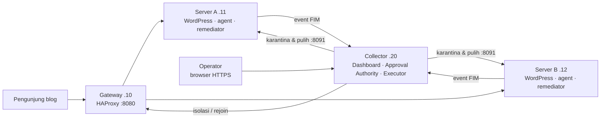

# DEFNETT

**Automated Incident Response dengan persetujuan operator.**

DEFNETT adalah lab pertahanan siber dua server di balik load balancer. Agent memantau integritas file dan collector menilai risiko. Saat file penting diubah, playbook respons baru berjalan setelah operator menyetujui: server target dikeluarkan dari HAProxy, dipulihkan dari salinan master tervalidasi, lalu dimasukkan kembali. Selama itu situs tetap melayani lewat server lainnya.

Karya untuk **Kartika Cyber Hackathon 2026**, kategori **Penangkalan**.

| | |
|---|---|
| Repositori | https://github.com/BlueSecc/DEFNETT |
| Slide penjelasan | https://www.canva.com/d/iTrcMg9nvcdA7o1 |
| Video demo | [isi tautan YouTube] |

## Daftar isi

- [Mengapa DEFNETT](#mengapa-defnett)
- [Fitur utama](#fitur-utama)
- [Arsitektur](#arsitektur)
- [Instalasi](#instalasi)
- [Petunjuk penggunaan](#petunjuk-penggunaan)
- [Pemecahan masalah](#pemecahan-masalah)
- [Hasil uji](#hasil-uji)
- [Tampilan](#tampilan)
- [Catatan keamanan](#catatan-keamanan)
- [Komponen dan atribusi](#komponen-dan-atribusi)
- [Rencana pengembangan](#rencana-pengembangan)
- [Untuk juri](#untuk-juri)
- [Dokumentasi lanjutan](#dokumentasi-lanjutan)

## Mengapa DEFNETT

Respons manual terlalu lambat, sedangkan otomasi penuh berisiko menjalankan tindakan yang keliru. DEFNETT menggabungkan kecepatan mesin dengan keputusan manusia:

- **Layanan tetap hidup.** Server yang diserang diisolasi tanpa memutus pengguna, selama ada server lain yang sehat.
- **Operator yang menentukan.** Temuan tidak pernah langsung dieksekusi. Playbook menunggu persetujuan operator yang sudah login, lalu dijalankan executor terpisah yang hanya bisa bekerja lewat persetujuan itu.
- **Bukti terjaga.** File yang rusak dikarantina, event dicatat di SQLite dengan hash chain, dan setiap tindakan operator tercatat.
- **Sumber pemulihan tervalidasi.** Salinan master kunci dilindungi manifes sha256; pemulihan menolak berjalan bila master tidak cocok.
- **Bisa di jaringan tertutup.** Kode backend tim hanya memakai pustaka standar Python, ditambah HAProxy dan SQLite, tanpa layanan cloud.
- **Waktu respons terukur.** Setiap insiden mencatat waktu deteksi, isolasi, dan pulih.

Ini purwarupa lab. Penerapan di lingkungan satuan memerlukan pengujian lanjutan.

## Fitur utama

| Fitur | Keterangan |
|---|---|
| Deteksi | Agent FIM memeriksa hash SHA-256 file dan mencatat login SSH/Web |
| Persetujuan operator | Setujui, Tolak, atau Pulihkan kunci; approval kedaluwarsa setelah 15 menit |
| Isolasi | Executor mengeluarkan server terdampak dari HAProxy setelah disetujui |
| Pemulihan | File rusak dikarantina, kunci dipulihkan dari master bermanifes sha256, lalu health check dan rejoin |
| Audit | Event dan tahapan playbook di SQLite dengan hash chain |
| Dashboard | Tab Overview, Patrol, dan Terminal, serta panel Detail (Events, File, Trajectory, Playbook, Trafik) |

## Arsitektur

Empat VM VirtualBox di jaringan host-only `192.168.56.0/24`, masing-masing dengan firewall ufw.



| VM | Alamat | Peran |
|---|---|---|
| Gateway | `192.168.56.10` | HAProxy, situs di `http://192.168.56.10:8080/` |
| Server A | `192.168.56.11` | Blog WordPress, app, agent FIM, remediator |
| Server B | `192.168.56.12` | Blog WordPress, app, agent FIM, remediator |
| Collector | `192.168.56.20` | Dashboard `https://192.168.56.20:8443/`, Collector, Approval Authority, Executor dengan UID terpisah |

Port yang terbuka di Server A dan B:

| Port | Layanan | Diizinkan dari |
|---|---|---|
| 22 | SSH | Laptop admin, Collector (tab Terminal) |
| 80 | Blog WordPress | HAProxy, laptop admin |
| 8080 | App DEFNETT dan health check | Laptop admin, HAProxy, Collector |
| 8091 | Remediator (karantina, pemulihan, simulasi serangan) | Collector saja |

**Alur respons insiden** (angka dari uji lab 3 November 2026):

1. Serangan mengubah file kunci, lalu agent mendeteksinya dalam 0,4–2,8 detik.
2. Approval pemulihan muncul dengan status PENDING.
3. Operator menekan **Setujui**. Executor mengeluarkan server dari HAProxy dalam 0,05–0,34 detik.
4. Remediator mengarantina file rusak dan memulihkan kunci dari master, dalam 0,5–2,0 detik di luar jeda demo.
5. Health check lolos, lalu server masuk kembali ke rotasi.

Bila operator menekan **Tolak**, tidak ada tindakan. Pemulihan bisa diminta ulang lewat **Pulihkan kunci**.

## Instalasi

Panduan lengkap langkah demi langkah ada di **[docs/INSTALASI.md](docs/INSTALASI.md)**. Ringkasnya:

| Cara | Cocok untuk | Waktu |
|---|---|---|
| [Docker](docs/INSTALASI.md#a-instalasi-dengan-docker) | Mencoba cepat di satu komputer (tanpa WordPress dan tab Terminal) | ±15 menit |
| [Empat VM VirtualBox](docs/INSTALASI.md#b-instalasi-di-empat-vm-virtualbox) | Demo lengkap seperti di video | ±2–3 jam |

**Docker, singkatnya:**

```bash
git clone https://github.com/BlueSecc/DEFNETT.git
```

```bash
cd DEFNETT && sh lab/build.sh
```

Catat kata sandi `admin` yang dicetak skrip, percayai `~/.config/defnett-lab/tls/ca.crt` di browser ([caranya](docs/INSTALASI.md#mempercayai-ca-lab)), lalu buka `https://127.0.0.1:8443/`.

**Empat VM, singkatnya:**

1. buat jaringan host-only `defnett` (`192.168.56.0/24`) dan empat VM Ubuntu Server;
2. siapkan IP, hostname, dan paket tiap VM;
3. pasang HAProxy, WordPress, dan layanan DEFNETT;
4. jalankan `lab/vm/cutover-stage.sh` dari laptop, lalu `cutover-vm.sh` di tiap VM.

Semua perintahnya ada di [panduan instalasi](docs/INSTALASI.md#b-instalasi-di-empat-vm-virtualbox).

**Pembaruan setelah kode berubah** (lab VM, dijalankan dari laptop). Password SSH dan sudo diketik sendiri, dan file lama dicadangkan sebagai `<nama>.bak-<waktu>`.

| Perintah | Kegunaan |
|---|---|
| `sh lab/vm/deploy-dashboard.sh` | Kirim file dashboard ke Collector (tanpa restart) |
| `sh lab/vm/deploy-terminal.sh` | Kirim `collector.py`, `web_terminal.py`, dan dashboard, restart Collector, lalu izinkan SSH dari Collector di ufw Server A/B. Tambah `SKIP_FIREWALL=1` bila aturan ufw sudah ada |
| `sh lab/vm/fix-server-a-keys.sh` | Pulihkan kunci Server A dari `/master` secara manual (menampilkan alasan gagal dulu, lalu minta konfirmasi `y`) |

**Pengujian otomatis**

```bash
python3 -m unittest discover -s lab/tests
```

## Petunjuk penggunaan

### Sebelum mulai

Pastikan hal berikut sudah siap:

- [ ] Lab sudah terpasang dan berjalan (lihat [Instalasi](#instalasi)).
- [ ] Browser sudah mempercayai sertifikat CA lab, sehingga `https://...:8443/` terbuka tanpa peringatan.
- [ ] Akun operator dashboard (dibuat `lab/build.sh` atau oleh admin lab).
- [ ] Untuk tab Terminal: username dan password akun Linux di Server A/B.

Istilah yang dipakai di dashboard:

| Istilah | Arti |
|---|---|
| Operator | Orang yang memantau dan memutuskan tindakan. Hanya operator yang bisa menyerang, menyetujui, dan membuka terminal |
| Approval | Permintaan tindakan yang menunggu keputusan operator: Setujui atau Tolak |
| Isolasi | Server dikeluarkan dari HAProxy, sehingga pengunjung dilayani server lain |
| Rejoin | Server dimasukkan kembali ke HAProxy setelah pulih dan lolos health check |
| Kunci | File contoh `etc/kunci1.dat` dan `etc/kunci2.dat` yang dijaga DEFNETT |
| Master | Salinan kunci yang sah, dicocokkan dengan manifes sha256 sebelum dipakai memulihkan |

### 1. Masuk sebagai operator

1. Buka dashboard: `https://192.168.56.20:8443/` (VM) atau `https://127.0.0.1:8443/` (Docker).
2. Klik **Masuk operator** di kanan atas, isi username dan kata sandi, lalu klik **Masuk**.
3. Indikator di kanan atas berubah dari "Belum masuk" menjadi **Online**.

Tanpa login, dashboard hanya menampilkan "Belum masuk": status server, port, dan Playbook tidak dimuat, dan tombol **SERANG!** serta tab **Terminal** tidak bisa dipakai. Akun *viewer* bisa melihat, tetapi tidak bisa menyetujui atau menyerang.

### 2. Tab Overview

Peta topologi Operator → Collector → HAProxy → Server A/B, plus status ringkas di baris atas.

- **Node dan kabel hijau:** komponen hidup dan tersambung.
- **Merah putus-putus:** mati atau terputus. Contohnya kabel HAProxy → Server A saat Server A diisolasi, atau semuanya merah bila Collector tidak terjangkau.
- **LB:** hijau selama minimal satu server masih UP (situs tetap melayani), merah bila tidak ada server UP.

### 3. Tab Patrol

Visualisasi game dari aktivitas di kedua server:

- **Polisi AI** berpatroli memeriksa hash file. **Satpam** menjaga pos dan memperbaiki file.
- **Pintu** di bawah tiap ruang adalah port yang terbuka di server: `22 SSH`, `80 HTTP`, `8080 APP`, `8091 REPAIR`.
- **Penyusup** masuk lewat pintu port. Bila server diisolasi, semua pintu tertutup dan penyusup terjebak, lalu dilumpuhkan saat perbaikan.

Ada dua cara memicu serangan:

1. **Demo** (simulasi lokal di browser, tidak mengubah server). Klik **Demo**. Penyusup bergantian masuk ke Server A dan B lewat port acak. Server yang dibobol diisolasi, diperbaiki, lalu kembali online, sementara server lain tetap melayani dan menolak penyusup di pintunya. Klik **Hentikan demo** untuk berhenti.
2. **SERANG!** (serangan lab sungguhan). Pilih **Server A** atau **Server B**, pilih jalur **SSH** atau **Web**, lalu tekan **SERANG!**. Executor menambahkan satu baris penanda ke `etc/kunci1.dat` di server target, agent mendeteksinya, dan approval pemulihan muncul di Playbook.

**SERANG!** ditolak bila server target atau server lainnya tidak UP (supaya situs tetap hidup), atau bila kunci server masih rusak dari serangan sebelumnya. Alasannya tampil di samping tombol.

### 4. Playbook (panel Detail)

Klik **Detail**, lalu tab **Playbook**. Di sini operator memutuskan:

| Tombol | Akibat |
|---|---|
| **Setujui** | Server dikeluarkan dari HAProxy, file rusak dikarantina, kunci dipulihkan dari master yang cocok manifes sha256, health check, lalu server masuk kembali ke rotasi |
| **Tolak** | Tidak ada tindakan. Server tetap melayani dan penyusup pergi, tetapi kunci dibiarkan rusak |
| **Pulihkan kunci** | Muncul setelah Tolak atau approval kedaluwarsa. Membuat approval pemulihan baru yang tetap harus disetujui |

Approval kedaluwarsa setelah 15 menit. Selama kunci belum dipulihkan, **SERANG!** ke server itu akan gagal dengan alasan *kunci masih rusak*; pakai **Pulihkan kunci → Setujui** untuk membereskannya. Tahapan playbook beserta waktu deteksi, isolasi, dan pulih tercatat di panel yang sama.

### 5. Tab Terminal

Shell SSH ke Server A atau Server B langsung dari dashboard (khusus lab VM):

1. Buka tab **Terminal**, lalu pilih **Server A** atau **Server B**.
2. Isi **username** akun server, lalu klik **Hubungkan**.
3. Ketik **password server** saat prompt `...'s password:` muncul di terminal.
4. Ketik `exit` atau klik **Putuskan** bila selesai.

Login tetap memakai akun server itu sendiri; kunci SSH tidak dipakai dan password tidak disimpan. Hanya operator yang bisa membuka terminal, maksimal 2 sesi per operator, dan sesi yang menganggur 15 menit ditutup otomatis. Tampilan terminal memakai xterm.js dari `cdn.jsdelivr.net`, jadi browser perlu akses internet.

### 6. Skenario demo lengkap

1. Buka dashboard dan masuk sebagai operator. Buka `http://192.168.56.10:8080/` di tab lain dan muat ulang beberapa kali: judul blog berganti antara **SERVER A** dan **SERVER B**.
2. Di tab **Patrol**, pilih **Server A** dan **SSH**, lalu tekan **SERANG!**. Penyusup masuk lewat pintu 22 dan mengubah file kunci.
3. Buka **Detail → Playbook**, lalu tekan **Setujui** pada approval *Pulihkan kunci dari master*.
4. Amati hasilnya:
   - pintu Server A tertutup dan kabel HAProxy putus (Overview merah untuk Server A);
   - blog tetap tampil lewat Server B;
   - penyusup dilumpuhkan dan file diverifikasi;
   - Server A kembali online.
5. Ulangi dengan **Server B** dan **Web**, lalu coba **Tolak** dan **Pulihkan kunci** untuk melihat alur penolakan.

## Pemecahan masalah

| Gejala | Penyebab | Solusi |
|---|---|---|
| Dashboard menampilkan "Belum masuk" dan data kosong | Belum login operator | Klik **Masuk operator** |
| **SERANG!** abu-abu | Server sedang insiden atau tidak UP | Tunggu insiden selesai atau cek status di Overview |
| **SERANG!** jalan tetapi tidak terjadi apa-apa | Kunci masih rusak (`key_not_pristine`) | **Detail → Playbook → Pulihkan kunci → Setujui** |
| Approval berstatus EXPIRED | Tidak disetujui dalam 15 menit | **Pulihkan kunci**, lalu Setujui |
| Terminal: "xterm.js tidak bisa dimuat" | Browser tanpa akses internet | Sambungkan laptop ke internet |
| Terminal langsung tertutup | SSH dari Collector diblok ufw | Jalankan `sh lab/vm/deploy-terminal.sh` atau cek aturan ufw |

Mengecek firewall di sebuah VM:

```bash
sudo ufw status numbered
```

Membandingkan dengan port yang benar-benar terbuka:

```bash
ss -ltn
```

## Hasil uji

- **Uji lab dengan persetujuan operator, 3 November 2026:** enam insiden di empat VM (Server A dan B, jalur SSH dan Web), semuanya disetujui operator, diisolasi, dan pulih. Seluruh 506 permintaan ke blog selama uji dijawab HTTP 200. Deteksi 0,4–2,8 detik, isolasi 0,05–0,34 detik setelah disetujui, dan pemulihan 0,5–2,0 detik di luar jeda demo. Rantai bukti utuh.
- **Uji keamanan VM:** TLS (CA tak dikenal, hostname salah, dan sertifikat kedaluwarsa ditolak), token, viewer tidak bisa menyetujui, Collector tidak bisa menjangkau HAProxy maupun remediator, dan login gagal tertutup saat Approval Authority mati.
- **Uji browser:** login, Serang, Setujui, Tolak, dan logout lewat Safari dengan HTTPS tepercaya.
- **Uji otomatis:** 96 test, 95 lulus dan 1 dilewati di macOS (butuh alamat `127.0.0.2`, yang hanya ada di Linux).
- **Belum diuji:** jalur Docker dan gateway OT Modbus di deployment.

Rincian ada di [Hasil Uji](docs/HASIL_UJI.md).

## Tampilan

Screenshot diambil 2 November 2026. Sejak itu dashboard mendapat panel Persetujuan, tab Terminal, warna status di Overview, dan toolbar Patrol di atas kanvas, jadi tampilan terbaru sedikit berbeda.

Overview:


Patrol. Pintu tiap server mengikuti port yang benar-benar terbuka:


Tab File, menampilkan file system tiap server per folder:


Serangan lewat SSH: intruder masuk lewat pintu 22.


Setelah file kunci diubah, Server A keluar dari HAProxy dan trafik pindah ke Server B:


Setelah file dipulihkan dan health check lolos, Server A kembali ke rotasi:


Serangan lewat Web: intruder masuk lewat pintu 80, dan Server B yang keluar dari rotasi.


**Situs yang dilayani.** Kedua server melayani blog WordPress di port 80, dan HAProxy membagi trafik ke keduanya. Setiap halaman memuat lencana serta judul **SERVER A** atau **SERVER B**, sehingga server yang menjawab langsung terlihat.


Konfigurasi gateway ada di [lab/vm/gateway/haproxy.cfg](lab/vm/gateway/haproxy.cfg). WordPress 5.0 memerlukan satu perbaikan agar halaman daftar tulisan tampil di PHP 8, yaitu [lab/vm/fix-wp-php8-home.sh](lab/vm/fix-wp-php8-home.sh).

## Catatan keamanan

Lab ini sengaja dibuat rentan dan **hanya untuk jaringan lab yang terisolasi**.

- **Perangkat lunak lama:** blog memakai WordPress 5.0, versi lama dengan kerentanan publik yang sudah diketahui. Versi itu dipilih karena tujuan lab ini adalah mengamati deteksi dan respons terhadap serangan, bukan menjaga situs tetap aman.
- **Data contoh:** `kunci1.dat`, `kunci2.dat`, akun blog, dan seluruh isi `/data` adalah data buatan.
- **Jangan dipasang di jaringan publik:** jangan dibuka ke internet dan jangan diisi data pribadi. Jaringan antar VM memakai host-only, dan firewall tiap VM hanya mengizinkan lalu lintas yang diperlukan.
- **Skor risiko berbasis aturan:** penilaian di dashboard bukan model AI terlatih. Tombol **Serang!** hanya membuat permintaan persetujuan untuk mengubah file kunci demo di server lab.
- **Tab Terminal:** Collector bisa membuka SSH ke Server A/B. Siapa pun yang memegang akun operator dashboard dan tahu password server bisa membuka shell lewat browser, jadi jaga kedua kredensial itu.

## Komponen dan atribusi

Dibuat tim:

| Komponen | Berkas |
|---|---|
| Agent FIM | `lab/agent.py` |
| Collector | `lab/collector.py` |
| Lapisan pengaman tahap 1 | `lab/db.py`, `lab/policy_gate.py`, `lab/approvals.py`, `lab/operator_auth.py`, `lab/provision_operators.py`, `lab/provision_master.py` |
| Executor | `lab/executor.py` |
| Remediator | `lab/remediator.py` |
| Terminal web | `lab/web_terminal.py` |
| Aplikasi demo | `lab/app.py` |
| Dashboard | `lab/dashboard` |

Seluruh kode di atas dibuat tim selama periode program, mulai Oktober 2026. Karya pre-existing yang dipakai hanya perangkat pihak ketiga di bawah ini, sesuai lisensi masing-masing:

| Pihak ketiga | Lisensi | Dipakai untuk |
|---|---|---|
| HAProxy | GPL-2.0 | Load balancer dan isolasi server |
| WordPress 5.0 | GPL-2.0 | Situs contoh di Server A dan B |
| Python, SQLite | PSF, domain publik | Runtime dan penyimpanan bukti |
| xterm.js | MIT | Tampilan tab Terminal, dimuat dari CDN |
| Docker, VirtualBox | Apache-2.0, GPL-2.0 | Menjalankan lab |

Dataset untuk eksperimen luring skor risiko tidak disertakan di repo karena ukurannya, dan tidak dipakai saat sistem berjalan:

- Sen, Ö., Bader, L., Emara, M., dkk. (2026). *Data4Cyber: Labeled Cyber-Physical Dataset for Distribution-Grid Management Systems Under Representative OT Attacks*. Zenodo. https://doi.org/10.5281/zenodo.19965384 (CC BY 4.0).
- ICS Telemetry Dataset, https://github.com/davidivory/ICS-telemetry-dataset (CC0 1.0).

Repo ini tidak memuat data pribadi pihak ketiga.

## Rencana pengembangan

Jika lolos ke babak selanjutnya, kami akan:

- **Membuat model ML untuk skor risiko**, agar penilaian lebih akurat daripada skor berbasis aturan yang dipakai sekarang.
- **Membatasi Polisi AI (agent FIM) ke izin read-only**, sehingga agent hanya bisa membaca dan memantau file.
- **Membatasi Satpam (remediator) ke izin execute dan write saja**, sehingga Satpam hanya menjalankan perbaikan dan menulis file pemulihan.

## Untuk juri

**Materi submission** (bagian G rulebook, batas akhir 15 November 2026 pukul 23:59 WIB). Kategori **Penangkalan**, tim maksimal 3 orang.

| Kelengkapan | Ketentuan rulebook | Isi |
|---|---|---|
| Link karya | Publik, bisa dicoba juri | https://github.com/BlueSecc/DEFNETT |
| Thumbnail | 1200×630 px, JPG/PNG/WebP, maks. 500 KB | [docs/thumbnail.jpg](docs/thumbnail.jpg) (1200×630, 117 KB) |
| Screenshot | Maks. 5 gambar | `01-overview`, `04-serangan-ssh-masuk`, `04-serangan-patrol`, `06-pulih`, `11-playbook-metrik` di [lab/screenshots](lab/screenshots) |
| Video | Maks. 10 menit, di YouTube | [isi tautan YouTube] |
| Slide | Fitur, arsitektur, teknologi | https://www.canva.com/d/iTrcMg9nvcdA7o1 |

## Dokumentasi lanjutan

- [Dokumentasi Teknis](docs/DOKUMENTASI_TEKNIS.md): komponen, alur insiden, API, keamanan, batasan.
- [Panduan Instalasi](docs/INSTALASI.md): Docker dan empat VM, langkah demi langkah.
- [Hasil Uji](docs/HASIL_UJI.md): rincian uji lab dan pengujian otomatis.
- [lab/README.md](lab/README.md): menjalankan lab dengan Docker dan detail endpoint.
- [lab/vm](lab/vm): konfigurasi dan skrip tiap VM.
