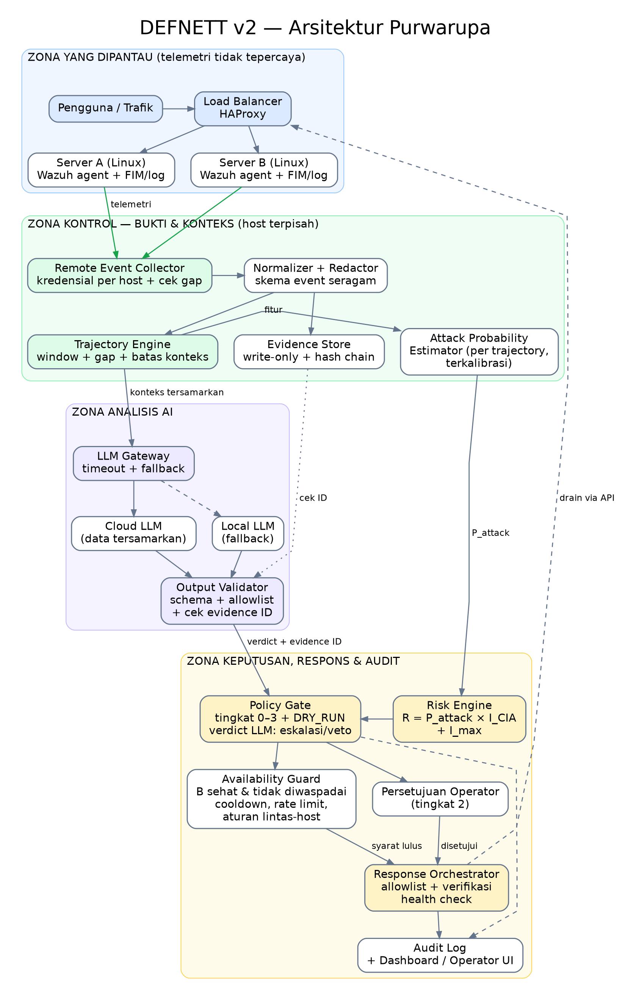
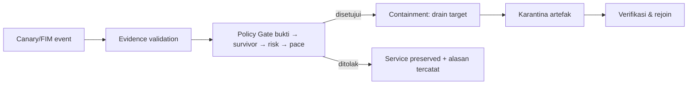

# DEFNETT

**D**eteksinya **E**vent, **F**IM, & **N**etsec lab-re*TT* — purwarupa *defense-in-depth* untuk layanan di balik satu HAProxy: dua server aplikasi dengan dua agent FIM (hash file, sha256, 3 detik), collector + hash chain SQLite, worker karantina per host, dan dashboard patroli. Kriteria keputusan dan penilaian risiko memakai **aturan deterministik**, bukan classifier atau LLM terlatih.



## Siklus demo utama



Satu-satunya playbook otomatis: karantina file canary bermarker pada host target, dengan server survivor tetap melayani (di-drain dari rotasi HAProxy). Kasus lain **gagal tertutup** dan ditandai untuk operator — bukan antivirus, bukan perbaikan OS.

## Jalankan (lokal)

```sh
docker compose -f lab/compose.yaml -f lab/compose.canary.yaml -f lab/compose.demo-fast.yaml up -d --build
```

- Dashboard: `http://127.0.0.1:8090/`
- Aplikasi lewat HAProxy: `http://127.0.0.1:8080/`
- Health: `http://127.0.0.1:8090/healthz`

Panduan lengkap, endpoint, dan batas purwarupa: [`lab/README.md`](lab/README.md).

## Uji & metrik

```sh
python3 -m unittest discover -s lab/tests       # 64 unit test
sh lab/test-scenarios.sh                        # 3 skenario Policy Gate + guard double-start (409)
sh lab/test-containment.sh                      # siklus drain → karantina → rejoin
RUNS=3 python3 lab/measure_metrics.py           # eksperimen fase (baseline/containment/recovery)
RUNS=3 python3 lab/measure_burst.py             # burst di jendela drain terverifikasi
```

Angka terbaru ([`lab/METRICS_REPORT.md`](lab/METRICS_REPORT.md), artefak di [`lab/test-results/`](lab/test-results/)): detection latency median ≈0,8 s; **88/88** request **koneksi-baru** di jendela drain **terverifikasi timestamp** mendapat HTTP 200 via survivor, **0** request ke target. Pengukuran lab terbatas — bukan jaminan ketersediaan universal.

## Struktur repo

| Jalur | Isi |
|---|---|
| `DEFNETT_PRD_v2.md` | Persyaratan produk + kasus instansi (Status: purwarupa) |
| `DEFNETT_Blueprint_v3.md` | Arsitektur target & pertanyaan evaluasi |
| `DEFNETT_Arsitektur_v2.md` | Diagram & alur komponen |
| `lab/` | Source lab + [`README.md`](lab/README.md) panduan lengkap |
| `lab/DEMO_SCRIPT.md` | Naskah demo 8 tahap |
| `lab/tests/`, `lab/test-scenarios.sh` | Unit + integrasi |
| `lab/test-results/`, `lab/METRICS_REPORT.md` | Artefak & laporan metrik |
| `archive/previous_versions/` | Dokumen pendahulu (v1/v2, arsip utuh) |

## Status yang jujur

- ✅ Berjalan: siklus containment terprogram, Policy Gate fail-closed, guard idempotensi, 64 unit test, harness metrik, dashboard skenario-driven.
- ❌ Belum: classifier terkalibrasi, integrasi LLM nyata (stub `llm_advisor.py`, default OFF), evaluasi A–D, eskalasi operator/alert, pemantauan di luar `/data`, bukti tahan-manipulasi produksi.

## Panduan kerja

- Token/kredensial hanya lewat environment variable (`COLLECTOR_INGEST_TOKEN`, `AGENT_TOKEN`); tidak ada secret di repo.
- Artefak pengujian di `lab/test-results/**` disimpan byte-for-byte (`-text -diff`) — jangan diedit angkanya manual; jalankan ulang harness untuk data baru.
